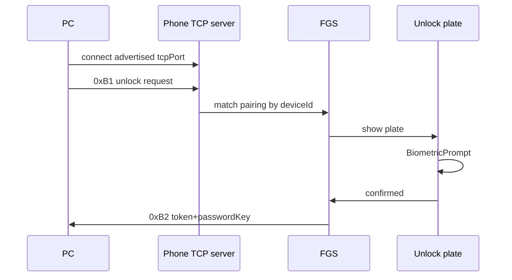
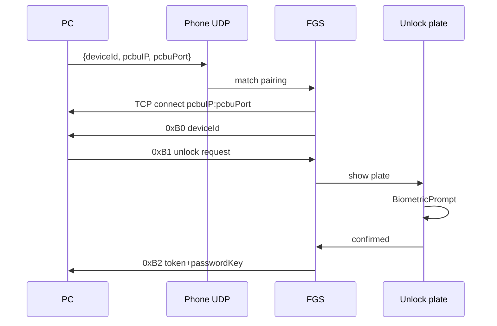

# Technical Architecture

## System context

JarvisAuth Android is a protocol client for the existing desktop in this repository. It does not replace Windows/PAM. It does not call HTTP/cloud APIs. Off-LAN lock/unlock may use Tailscale overlay IPv4 (`100.64.0.0/10`, optional JSON `tsIP`) per `agentic/features/internet-reach/`.

```
┌─────────────┐  QR / LAN / BT   ┌──────────────────┐     password      ┌─────────────┐
│  Android    │ ◄──────────────► │ JarvisAuth       │ ───────────────► │ Windows PAM │
│  phone app  │  encKey+pwKey    │ desktop          │   via OS login   │ / Winlogon  │
└─────────────┘                  └──────────────────┘                  └─────────────┘
     holds keys only                  holds encrypted password
```

Transports after pairing:

| Method | Who listens | Who connects |
|---|---|---|
| UDP / MANUAL_UDP | Phone UDP socket; PC also opens TCP unlock server | Phone connects to `pcbuIP:pcbuPort` from broadcast |
| TCP | Phone TCP server on advertised `tcpPort` | PC connects to phone |
| Bluetooth | Phone RFCOMM server | PC connects to phone |

## Technology stack and rationale

| Piece | Choice | Why |
|---|---|---|
| Language / UI | Kotlin 2, Jetpack Compose, minSdk 26, target 35 | Locked in discovery |
| QR scan | CameraX + ZXing core | No Play Services (sideload) |
| Biometrics | androidx.biometric | Device-credential fallback |
| Crypto | `javax.crypto` AES/GCM/NoPadding + PBKDF2WithHmacSHA256 | Must match OpenSSL in `CryptUtils.cpp`; IV length **16** (not the usual 12) |
| TCP/UDP | `java.net.Socket` / `DatagramSocket` | Exact binary framing; HTTP stacks cannot |
| Bluetooth | `BluetoothServerSocket` RFCOMM | Same UUID as desktop client |
| Storage | androidx.security.crypto `EncryptedFile` for pairings JSON | Secrets never in plaintext prefs |
| DI | Manual graph in `JarvisAuthApp` | One process, no Hilt tax |
| Coroutines | kotlinx.coroutines | IO on `Dispatchers.IO`; UI on Main |
| Navigation | Compose Navigation, single activity | Matches design IA |
| QR fonts | Sora, IBM Plex Mono as `res/font` | Design tokens |

Not used: Retrofit, Room, Firebase, ML Kit, WorkManager (a FGS already runs).

## Component and service boundaries

Package root: `com.jarvisauth.app`

```
app/
  ui/                 Compose only. No sockets, no crypto.
  domain/             PairPc, StartListener, StopListener, ConfirmUnlock, RemovePc
  data/               PairingStore
  protocol/           Framing, AesGcmPacket, PairingPackets, UnlockPackets
  transport/          UdpUnlockListener, TcpUnlockServer, RfcommUnlockServer, TcpUnlockClient
  service/            UnlockForegroundService
```

**Rule:** composables call view-model methods. View-models call domain. Domain calls protocol/transport/store. Transport never imports Compose.

**UnlockForegroundService** is the process that owns sockets. It:

1. Reads pairings from `PairingStore`.
2. Starts UDP bind for each distinct `udpPort` / `udpManualPort`.
3. Starts one TCP server on the persisted `tcpPort` if any pairing is TCP.
4. Starts RFCOMM if any pairing is Bluetooth.
5. On an inbound unlock request, posts a full-screen intent to `UnlockActivity` and suspends until Confirm/Cancel.
6. Writes the unlock response on the same socket, then closes.

The UI process and the service are the same app process. Unlock state is a shared in-memory `UnlockSession` held by the application graph, not a database.

**Pairing** runs in the UI process (short-lived TCP client + optional UDP discovery). It does not use the FGS.

## Data model and storage

Persisted (encrypted JSON file `pairings.json`):

```
Pairing
  deviceId: String          // desktop SHA256 id
  encryptionKey: String     // QR encKey
  passwordKey: String       // wrapping key; never logged
  pairingMethod: UDP | TCP | BLUETOOTH | MANUAL_UDP
  pcName: String
  pcOs: String
  userName: String
  unlockServerPort: Int
  macAddresses: List<String>
  pairedAtEpochMs: Long
```

App-local (encrypted, same file or `device.json`):

```
LocalDevice
  uuid: String              // random, created once
  displayName: String       // Bluetooth name / Build.MODEL
  tcpPort: Int              // stable, advertised at pair
  udpPort: Int
  udpManualPort: Int
```

Ports are generated once (defaults 43310 / 43311 / 43312, bump on bind conflict, then persist). Changing them after pairing breaks TCP/UDP until re-pair.

No Room. A few kilobytes of JSON.

## API contracts

This app has no HTTP API. The contract is the desktop binary protocol.

**Framing** (all integers network byte order):

```
u64 header = 0xDB065AC7AFDFA4CC
u16 packetId
u16 payloadLength
u8  payload[payloadLength]
```

**AES packet blob** (also hex-encoded as `encData` in unlock JSON):

```
u8 iv[16]
u8 salt[16]
u8 ciphertext[...]
u8 gcmTag[16]
```

Plaintext before encrypt: `u64 timestampMsBE || payload`. Decrypt must reject `|now - timestamp| > 120s`.

Key derivation: PBKDF2-HMAC-SHA256, 65535 iterations, 32-byte key, salt from the blob.

**Pairing**

- Phone → PC `0x50` JSON: `{protoVersion:"4.0.0", deviceUUID, deviceName, ipAddress, tcpPort, udpPort, udpManualPort, cloudToken:""}` encrypted with QR `encKey`.
- PC → Phone `0x51` JSON: `{errMsg, data:{pairingMethod, deviceId, deviceName, deviceOS, unlockServerPort, macAddresses, userName, passwordKey}}`.

**Unlock**

- Phone → PC `0xB0` raw UTF-8 `deviceId` only when the **phone initiated** the TCP connection (UDP / MANUAL_UDP). Desktop `TCPUnlockServer` waits for it (`needsDeviceID=true`).
- When the **PC connected in** (Automatic TCP / Bluetooth), desktop `TCPUnlockClient` already has the pairing and sends `0xB1` immediately (`needsDeviceID=false`). The phone must **not** send `0xB0`; that packet is unexpected and fails the PC.
- PC → Phone `0xB1` JSON `{protoVersion:"3.0.0", deviceId, encData}` where `encData` decrypts to `{user, program, unlockToken}`.
- Phone → PC `0xB2` JSON `{error, encData}`. Success: `error` empty, `encData` decrypts to `{unlockToken, passwordKey}` with the **same** token. Failure: `error` in {`CANCEL`,`TIME_ERROR`,`DATA_ERROR`,`NOT_PAIRED`,`PROTOCOL_ERROR`,`APP_ERROR`}, `encData` empty.

**UDP unlock broadcast** (plaintext JSON, not AES): `{deviceId, pcbuIP, pcbuPort, isManual}` to the phone’s `udpPort` or `udpManualPort`.

**UDP pairing beacon** (AES with QR `encKey`): `{serverId, ip, port}`.

**Bluetooth:** RFCOMM service UUID `62182bf7-97c8-45f9-aa2c-53c5f2008bdf`, same framing as TCP.

**Lock / power (Windows, logged-in GUI only)** — see `agentic/features/lock-pc/architecture.md` and `agentic/features/power-control/architecture.md`.

- Phone → PC `0xB3` JSON `{protoVersion, deviceId, encData}` where `deviceId` is `PairedDevice.id` (SHA256 of machineID+phoneUUID+userName, same id the phone stores). `encData` decrypts to `{pcDeviceId, nonce}` and, for proto `1.1.0`, inner `action` `shutdown`|`restart`|`lock`. Lock PC uses proto `1.0.0` with no `action`. `pcDeviceId` must equal that pairing id.
- PC → Phone `0xB4` JSON `{error, encData}`. Success: empty `error`, `encData` decrypts to `{nonce}` echo. Failure codes match unlock. Never `passwordKey`. No `0xB0` on this socket.
- TCP port default **43298** (`lockServerPort`). Must not bind 43296. Desktop accepts proto `1.0.0` (lock) and `1.1.0` (action).

## External integrations

- Android OS only: Camera, Bluetooth adapter, BiometricPrompt, full-screen notifications, REQUEST_IGNORE_BATTERY_OPTIMIZATIONS (prompt, not silent).
- No MeisApps, no Play, no crash reporter, no Google login.

## Authentication and authorization

There is no user account. Authorization for an unlock is:

1. Socket is for a stored `deviceId`.
2. Payload decrypts with that pairing’s `encryptionKey`.
3. Protocol version matches.
4. Timestamp is fresh.
5. BiometricPrompt (or device credential) succeeds in this session.
6. Response token equals the request token.

Fail any step → send error or close; never send `passwordKey`.

## Security and privacy

- `passwordKey` and `encryptionKey` only in encrypted storage and in memory during an active handshake.
- Logs: method, deviceId prefix, error codes. Never keys, never full payloads, never hex `encData`.
- QR `encKey` is plaintext by desktop design; scanner UI warns to put the QR away after pairing.
- Cleartext UDP broadcast can leak that an unlock is happening on the LAN; payload has no keys. Do not “fix” by changing the desktop.
- Backup: disable Auto Backup for the encrypted file (`android:allowBackup="false"`).
- Screenshot: pairing and unlock activities set `FLAG_SECURE`.

## Performance and scalability

One user, a handful of PCs. Sockets are few. Crypto is small (2KB cap in desktop `CRYPT_BUFFER_SIZE` — reject larger). No thread pool beyond a single IO dispatcher plus one acceptor per transport. Do not keep a wake lock beyond the FGS.

## Observability

In-app log ring (last ~500 lines) behind Settings, plus logcat at DEBUG when “debug logging” is on. Same redaction rules. No remote ingest.

## Deployment and environments

- Module `android/` in this repo, Gradle Kotlin DSL, JDK 17.
- `assembleDebug` / `assembleRelease` APK. Release is signed with a local keystore not committed to git.
- No flavors beyond debug/release. Debug applicationId stays `com.jarvisauth.app` (sideload one install).
- Desktop stays an independent CMake build. Do not couple Gradle to vcpkg.

## Testing strategy

1. **Golden crypto tests (JVM):** encrypt/decrypt vectors that match `CryptUtils` (16-byte IV, salt, tag, timestamp prefix, 65535 PBKDF2). If a vector fails, the app must not ship.
2. **Framing tests:** header/id/length round-trip, truncated streams, wrong header byte reset (desktop reads header bytewise).
3. **Packet JSON tests:** pair init/response, unlock request/response, UDP broadcast parse.
4. **Domain tests:** cancel does not emit success; unknown deviceId → `NOT_PAIRED`; proto mismatch → `PROTOCOL_ERROR`.
5. **Manual hardware:** QR pair; UDP unlock; TCP unlock; BT unlock; cancel; second PC; force-stop app then confirm no unlock.

No emulator-only sign-off for Bluetooth.

## Architectural decisions and consequences

**AD-1 Protocol clone, not a new API.** Consequence: Android cannot “improve” field names (`pcbuIP` stays). Desktop bugs (UDP broadcast is plaintext; UDP pairing also opens a TCP unlock server) are compatibility surface, not cleanup tasks.

**AD-2 Raw sockets, not Ktor.** Consequence: more boilerplate, exact bytes.

**AD-3 FGS owns listeners.** Consequence: automatic unlock requires the user to Start listening; force-stop fails closed (PRD AC7/AC6).

**AD-4 Full-screen intent for the plate.** Consequence: notification permission is mandatory on API 33+; some OEMs still suppress it.

**AD-5 ZXing instead of ML Kit.** Consequence: slightly worse scan UX, works without GMS.

**AD-6 EncryptedFile JSON, not Room.** Consequence: no query language; fine for N<20 pairings.

**AD-7 Stable listen ports persisted at first run.** Consequence: reinstall (new uuid/ports) requires re-pair.

## Diagrams

Runtime (armed, TCP pairing):



Runtime (armed, UDP pairing):



Module dependency (compile):

```
ui → domain → data
           → protocol
           → transport → protocol
service → domain
```

`ui` must not depend on `transport`.
