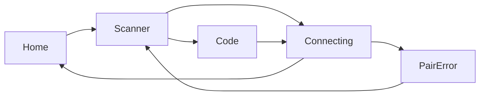
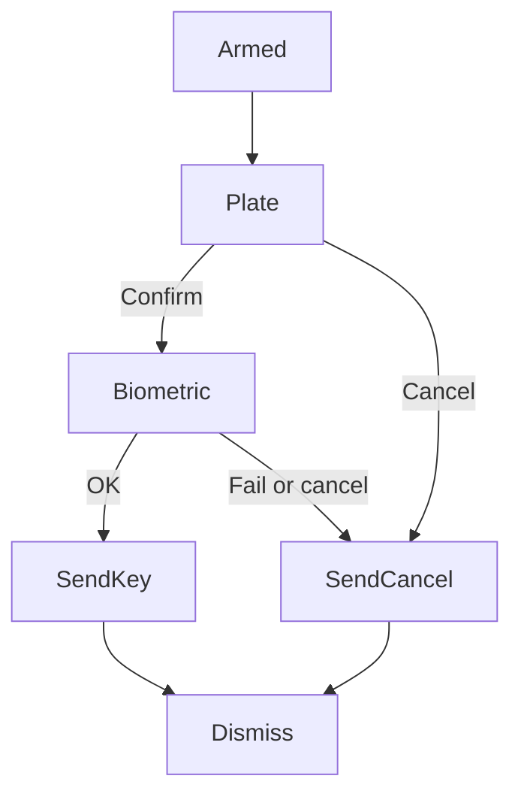

# Product Design

## Design principles

1. **The phone is a key, not a dashboard.** One job on every screen: pair, listen, or confirm. No stats, no empty “security score,” no card mosaic.
2. **Armed or idle is the only status that matters.** If the listener is down, the home screen must look disarmed. If it is up, that fact is the loudest UI.
3. **Unlock takes the whole device.** When a PC asks, navigation disappears. The screen is a lock plate: who is asking, what they want, confirm or refuse.
4. **Copy names what the user controls.** “Listening,” “Scan the code on your PC,” “Clocks don’t match.” No “establish session,” no “credential provider.”
5. **One accent, spent once.** Brass means armed / primary action. Everything else is graphite and paper. Red is only for refuse and failure.

Visual thesis: a locksmith bench at night — warm-black metal, one brass edge, pairing codes in mono like a cut key number. Not neon fortress, not cream-and-serif lifestyle app.

## User journeys and flows

**First run → pair**  
Launch → empty home (“No PCs yet”) → Pair PC → camera (or Enter code) → Connecting → Paired → home with one PC and Listening off until the user starts it.

**Arm listener**  
Home → Start listening → system FGS notification “JarvisAuth is listening” → home top rail turns brass → battery-optimization sheet if the OEM will kill the service.

**PC login (automatic UDP/TCP/BT)**  
Phone locked or in-app → full-screen unlock plate (even over lock screen via high-priority notification / full-screen intent) → biometric → success flash → back to previous state. Cancel / fail → plate dismissed, PC stays locked.

**Manual UDP**  
Home → Listen now (manual pairing only) → same unlock plate when the broadcast arrives → Stop listening.

**Unpair**  
Home → PC row → Remove → confirm → gone. No undo toast that re-sends keys.

**Error**  
Any failure stays on the same screen with a one-sentence cause and one action (Retry, Check time, Open Bluetooth). No generic “Something went wrong.”

## Information architecture

Single activity, three destinations plus two overlays:

- **Home** — paired PCs, listener control
- **Pair** — QR / code
- **PC detail** — spec sheet, lock, remove (reached from a row, not a tab)
- **Unlock plate** — overlay, not in the back stack as a place to browse
- **Logs** — overflow, not primary nav

No bottom bar. No drawer. Layout is **index + dock**, not a settings list: the list (or poster) owns the canvas; the one primary action sits in a bottom dock under a hairline. Pair is a masthead action when PCs exist, and the dock primary when the home is empty. Logs and battery help are quiet dock footnotes, not refuse-colored actions.

```
Home
 ├── Pair PC → Scanner | Code → Connecting → Home
 ├── PC row → Detail → Unlock PC | Lock PC | Shut down | Restart | Remove
 ├── Start / Stop listening
 └── Overflow → Logs | Battery help
Unlock plate (system overlay)
```

## Screens and states

**Home / empty**  
Poster: brand at display size, Mute eyebrow “No PCs yet,” one line of body copy. Dock: Pair PC. Quiet Logs footnote.

**Home / paired, idle**  
Masthead: JarvisAuth as a small stamp, page title **Idle**, Pair PC as a quiet action on the right. Key rack: hostname at 22, state caption, method in Plex Mono on the trailing edge. Row 80dp, hairline between rows, no chevron, no cards. Dock: Start listening. Footnotes: Logs · Battery help.

**Home / paired, armed**  
Same rack. Page title **Listening**. Rail brass. Dock becomes Stop listening. FGS notification mirrors this.

**Pair / scanner**  
Full-bleed camera, dimmed frame, caption “Point at the QR on your PC.” Secondary: Enter code instead. Close in the corner. No bench rail over the camera.

**Pair / code**  
Hairline rail. Masthead Close. Title + mono field. Dock: Connect.

**Pair / connecting**  
Hairline rail. “Connecting to PC…” as the canvas title. Dock: Cancel.

**Pair / error**  
Cause + Retry + Close. Protocol mismatch: “This phone and PC are on different versions.” Time: “Clocks don’t match. Set both to the same time.”

**PC detail**  
Hairline rail. Close in the masthead. Hostname at 34 (same scale as the unlock plate). Spec sheet: label left, value right, hairline rows — OS, method, user, truncated device id, Tailscale (`100.x` or “Not seen”). Not stacked Steel blocks. Dock: Unlock PC brass, Lock PC ghost (`agentic/features/internet-reach/design.md`), then quieter Shut down | Restart (`agentic/features/power-control/design.md`). Remove is a refuse footnote under the dock.

**Unlock plate**  
PC hostname (largest type). Line 2: user. Line 3: program (“Windows login”, “sudo”). Confirm (starts BiometricPrompt). Cancel. No other chrome.

**Unlock / success**  
Hostname stays, caption “Unlocked.” Auto-dismiss ~800ms.

**Unlock / denied**  
Caption “Not unlocked.” + reason. Dismiss.

## Interaction behavior

- Pairing is linear; back always abandons the in-flight pair and does not leave a half-saved PC.
- Start listening asks for runtime permissions at the moment of use (camera on Pair, Bluetooth on BT methods, notifications on Start).
- Unlock plate uses a full-screen intent so a locked phone still shows the question. Tapping Confirm runs BiometricPrompt; success is the only path that writes the unlock response.
- Cancel on the plate or on the biometric sheet sends `CANCEL` and closes the plate.
- Pull-to-refresh does not exist. This is not a feed.
- Motion: rail color crossfades 180ms; plate slides up 200ms; success does not bounce. `prefers-reduced-motion` → instant cuts.
- Pairing QR on the PC is a secret; the scanner caption is “Don’t leave the QR on screen after pairing.”

## Responsive behavior

Phone-only v1. No tablet layout, no landscape redesign. Unlock plate stays portrait-locked so the lock-plate composition does not collapse. Scanner uses the full window including cutouts; controls sit in the system-gesture safe area.

## Accessibility

- Unlock Confirm and Cancel are 48dp minimum.
- Unlock plate contrast: paper on night ≥ 7:1 for hostname.
- BiometricPrompt is the platform sheet (TalkBack already knows it). The plate still has a text Confirm so the flow is labeled before the system sheet.
- All status (Idle / Listening) is text, not color-only. The brass rail is redundant with the word “Listening.”
- Reduced motion respected.
- Pairing code field is a content description “Pairing code,” not “JSON payload.”

## Visual direction

Locksmith bench, not a consumer “security app.” Graphite surfaces, brass only when the key is in play (armed listener, Confirm, focus). Pairing codes and device IDs in mono, like a stamped key number.

Signature element: a **2dp armed rail** on the top edge of every bench screen (Home, detail, pair-code, logs). Steel when idle, brass when listening. No pulse, no glow. Scanner and unlock plate stay rail-less (camera and lock metal). If that rail is gone, the product looks like every other dark settings list — so it stays.

Layout risk: **index + dock**. The canvas is a key rack (or empty poster). The one brass control lives in a bottom dock, not in a stack of equal buttons. Brand recedes to a stamp once PCs exist; Idle / Listening is the page title.

Deliberate risk: the unlock UI is a full-screen plate, not a Material dialog or fingerprint illustration. The phone becomes the lock. No shield glyph.

Avoid: Material red+teal (legacy Qt default on this desktop — replaced by the locksmith tokens below), acid green on black, cream serif, glass cards, gradient orbs, numbered “01 02 03” decorations, stock fingerprint heroes, 56dp settings rows, Steel “card” stacks, chevrons, refuse-red Close/Logs.

## Desktop shell

Same tokens and index + dock. The Qt GUI is the bench the phone keys into, not a Material Red/Teal settings tool.

- 2dp rail on the window: Hairline until the login module is installed, Brass when it is.
- Masthead: JarvisAuth stamp, page title **Not installed** / **Idle** / **Paired**.
- Home canvas is the phone list (name, user, method trailing). No GroupBox pair, no 3-column table chrome.
- Dock: one brass primary — **Install** if the module is missing, **Pair device** once it is installed. Settings, logs, about, uninstall are quiet.
- Close (X) hides the window to the system tray. The process stays running so lock-from-phone still works. Restore with the tray icon (Open / click). **Quit** on the tray menu is the only way to stop JarvisAuth.exe.
- Pairing steps keep Next/Back in the dock; Next is brass. QR stays large; pairing code is mono.
- Unlock test is a small plate: status, brass action, no extra chrome.

Do not add a lock-port field to Settings in this slice.

## Design system

### Colors

| Token | Hex | Use |
|---|---|---|
| Night | `#12140F` | App background |
| Steel | `#1C1F18` | Raised surface (detail, fields) |
| Hairline | `#2A2E24` | Dividers, idle rail |
| Brass | `#C4A574` | Armed rail, primary actions, focus |
| Brass dim | `#8A7349` | Pressed primary |
| Paper | `#E8E2D4` | Primary text |
| Mute | `#9A9486` | Secondary text |
| Refuse | `#B54A3A` | Cancel, remove, errors |
| Ok | `#8A9A6A` | Success caption only |

### Typography scale

- UI / display: **Sora** (regular 400, semibold 600). Geometric, slightly cut, used for JarvisAuth, PC hostnames, buttons.
- Mono: **IBM Plex Mono** (400). Pairing codes, IPs, ports, device IDs. Never for headlines.
- Scale: caption 12 / body 16 / title 22 / hostname-on-plate 34 / brand-on-empty 40. Line height 1.25–1.4. Sentence case everywhere.

### Spacing

4dp grid. Screen padding 20. Key-rack row 80. Spec row 48. Section gap 24. Dock padding 16 above / 20 below, hairline on top of the dock. Unlock plate content inset 28. No 8-and-12 mixed guesses.

### Radii

Fields and buttons 6dp. Lists are not cards; they are rows with hairline separators. Scanner frame 8dp. No 24dp “pill soup.”

### Shadows

None. Elevation is a hairline and a surface step (Night → Steel). Unlock plate is Night, not a floating card.

### Icons

Stroke 1.5, 24dp, Paper. Sparse: plus (pair), close, bluetooth, wifi, key (app icon only). No filled shields. App icon: a simple keyway cut in graphite with a brass bit — if no custom asset is supplied, a monochrome key glyph on Night is enough for v1.

### Components and variants

- **Armed rail** — 2dp top edge; Hairline idle, Brass armed. Crossfade 180ms.
- **Primary button** — Brass fill, Night text, 48dp height. Only one per screen, in the dock.
- **Ghost button** — Hairline stroke, Paper text (Cancel, Enter code, Keep).
- **Quiet text** — Paper, no fill (Close, Pair PC, Logs, Battery help, Dismiss).
- **Refuse button** — no fill, Refuse text (Remove, Cancel on the unlock plate).
- **PC row** — hostname Sora 22, state Mute 12, method Plex Mono 12 trailing. No chevron. Tap → detail.
- **Spec row** — label Mute 12 leading, value Paper (Plex Mono for ids) trailing, 48dp, hairline under.
- **Field** — Steel fill, Hairline border, Brass border on focus, Plex Mono for codes.
- **FGS notification** — title “JarvisAuth is listening”, text “Unlock requests will appear here.” Stop action.

### Interactive states

- Default / pressed / disabled (primary at 40% opacity, not greyed brass-on-grey mush).
- Focus: 2dp Brass ring, offset 2dp, for keyboard/D-pad.
- Error fields: Refuse border + caption below, not a toast.
- Unlock Confirm pressed: Brass dim before the biometric sheet.

## Diagrams

Home, idle:

```
+----------------------------------+
| ▬▬  (steel rail)                 |
| JarvisAuth              Pair PC  |
| Idle                             |
|                                  |
|  WORKSTATION-01            UDP   |
|  Idle                            |
|  --------------------------------|
|  LAPTOP                    BT    |
|  Idle                            |
|                                  |
|  --------------------------------|
|        [ Start listening ]       |
|         Logs     Battery help    |
+----------------------------------+
```

Unlock plate:

```
+----------------------------------+
|                                  |
|  WORKSTATION-01                  |
|  satya                           |
|  Windows login                   |
|                                  |
|                                  |
|      [ Confirm ]                 |
|        Cancel                    |
+----------------------------------+
```

Pairing flow:



Unlock flow:


