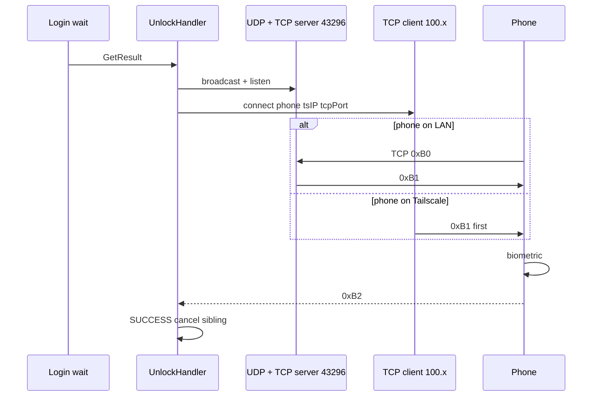
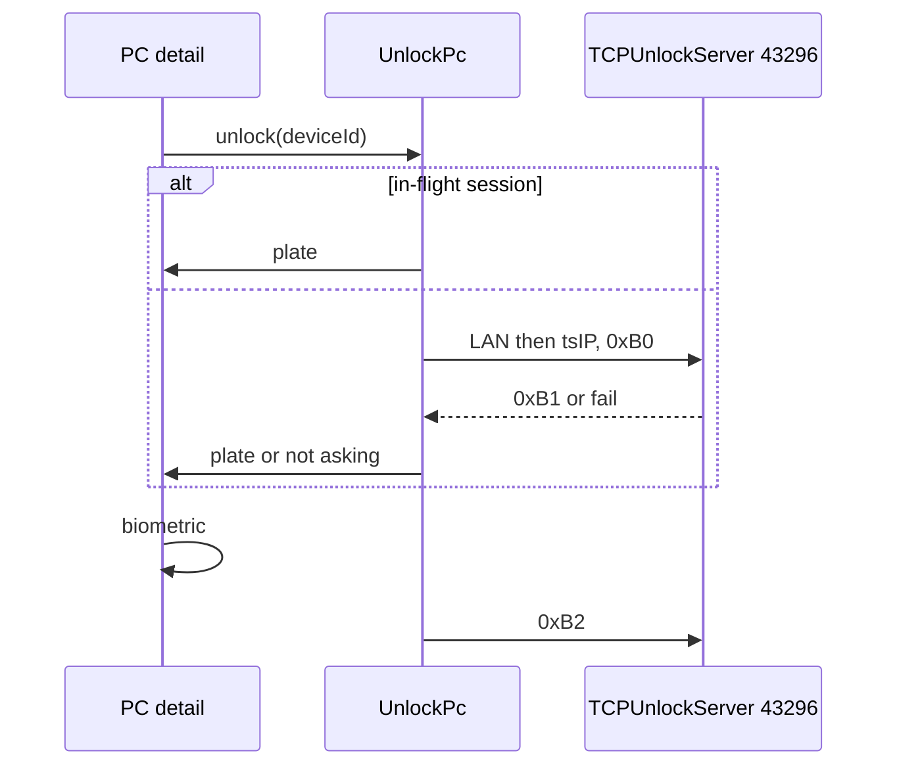

# Technical Architecture

## System context

Tailscale.com is an overlay the user already runs. JarvisAuth still speaks unlock `0xB0`–`0xB2` and lock `0xB3`/`0xB4` to IPv4 addresses. Some of those addresses are `100.64.0.0/10`. JarvisAuth does not call Tailscale.

```
Phone (LAN and/or 100.x)          PC (LAN and/or 100.x)
  TCP listen tcpPort  ◄──────────  TCP unlock client   (PC-initiated, all methods if tsIP stored)
  UDP listen          ◄──────────  LAN UDP broadcast    (UDP methods, LAN only)
  TCP connect 43296   ──────────►  TCP unlock server    (UDP today; this feature: every method during wait)
  TCP connect 43298   ──────────►  LockServer           (tray process)
```

Windows login/PAM still owns the password. Unlock wait process binds 43296. JarvisAuth.exe (tray) binds 43298.

## Technology stack and rationale

| Piece | Choice | Why |
|---|---|---|
| Overlay | Tailscale.com apps, not a SDK | User already has a tailnet; no Tailscale API in-process |
| Transport | Existing `java.net.Socket` / C++ `TCPUnlockClient` / `TCPUnlockServer` | Same framing |
| Crypto | Existing AES-256-GCM 16-byte IV | Frozen unlock/lock |
| Address class | `100.64.0.0/10` (RFC 6598 / Tailscale) | Distinguish from RFC1918 LAN |
| Android | `UnlockPc` + existing `TcpUnlockClient`; `LockPc` tries two hosts | UI still has no sockets |
| Dual-path | Existing `UnlockHandler` connection list + first-success cancel | Do not start a second unlock token |

Not used: Tailscale SDK, HTTP, Firebase, STUN, Headscale, meis-apps.com, new unlock packet IDs.

## Component and service boundaries

**Android**

- `domain/OverlayIpv4` — classify LAN vs `100.64/10`; read the phone’s current Tailscale IPv4 from local interfaces (no API).
- `domain/UnlockPc` — if `UnlockSession` for that pairing, resume plate; else LAN then Tailscale connect to `unlockServerPort`, `0xB0` first.
- `domain/LockPc` — LAN `lastIpv4` then `lastTailscaleIpv4`, port 43298.
- `data` — persist `lastTailscaleIpv4` on `Pairing`. Do not clobber `lastIpv4`.
- `protocol` — optional `tsIP` on UDP broadcast, pair init, `0xB1` outer JSON, `0xB2` outer JSON, `0xB3` outer JSON. Unknown keys ignored both ways.
- `transport` — bind unlock TCP/UDP/RFCOMM on `0.0.0.0`. No Tailscale-specific socket type.
- `ui/home/PcDetailViewModel` — Unlock PC / Lock PC per design.
- FGS still owns PC-initiated listeners. Unlock PC does not start FGS.

**Desktop**

- `NetworkHelper` — accept `100.64/10` as overlay; do **not** rank it as the default pairing/LAN interface.
- `PairedDevicesStorage` — additive `tsIP` on `PairedDevice` (phone overlay). Keep `ipAddress` as LAN/TCP target.
- `UnlockHandler` — always start `TCPUnlockServer` during a wait (UDP, TCP, BT). For UDP/BT (and TCP if `tsIP` set), also `TCPUnlockClient(tsIP, tcpPort)`. On first `SUCCESS`, stop siblings immediately so a second `passwordKey` cannot apply.
- `UDPUnlockBroadcaster` — additive `tsIP` = this PC’s overlay IPv4 when present. `pcbuIP` stays the LAN source IP.
- `LockServer` — unchanged packets; already reachable on Tailscale if the process is listening on `0.0.0.0`.
- Qt UI — no Tailscale settings.

`ui` must not import `transport`. No crypto in QML or Compose.

## Data model and storage

Android `Pairing` additive:

```
lastTailscaleIpv4: String = ""   // PC 100.64/10; never a hostname
```

`lastIpv4` remains LAN only. Fill overlay from: UDP `tsIP`, `0xB1` `tsIP`, inbound peer if it is `100.64/10` (store overlay, do not write it into `lastIpv4`).

Desktop `PairedDevice` additive:

```
tsIP: String = ""   // phone 100.64/10
```

Fill from: pair init `tsIP`, `0xB2` outer `tsIP`, lock `0xB3` outer `tsIP`. Do not put overlay in `ipAddress`.

Phone local Tailscale IPv4 is read at send time, not stored as the source of truth.

## API contracts

Framing, AES, 120s skew, header, ports 43296 / 43298: unchanged.

**Optional additive JSON** (omit when empty). Old peers ignore unknown keys.

UDP broadcast (plaintext, LAN):

```
{ "deviceId", "pcbuIP", "pcbuPort", "isManual", "tsIP": "100.x" }
```

`pcbuIP` remains LAN. Do not rename it.

Pair init (encrypted with QR `encKey`): existing fields plus `"tsIP"`. `ipAddress` may stay `""` or LAN; do not use it as the only overlay store.

Unlock request PC → phone `0xB1` outer:

```
{ "protoVersion": "3.0.0", "deviceId", "encData", "tsIP": "100.x" }
```

`encData` shape unchanged (`user`, `program`, `unlockToken`).

Unlock response phone → PC `0xB2` outer:

```
{ "error", "encData", "tsIP": "100.x" }
```

`encData` still `{ unlockToken, passwordKey }` after biometric only.

Lock request `0xB3` outer: existing fields plus `"tsIP"`. Inner encData unchanged. No `passwordKey`.

`0xB0` stays a **raw pairing-id string**. Do not JSON-wrap it (old desktop `GetDeviceByID` on the whole payload).

Phone-initiated Unlock PC uses the UDP server path: connect 43296, `0xB0`, wait `0xB1`, plate, `0xB2`. Connect timeout 8s per hop (LAN then Tailscale), not the long login wait.

PC-initiated Tailscale TCP client is `0xB1` first (no `0xB0`), same as today’s TCP method.

## External integrations

- Tailscale.com Windows + Android apps (user-installed). JarvisAuth does not start the Tailscale service.
- Windows: existing `LockWorkStation`, credential provider / PAM unlock wait.
- No Tailscale HTTP API, no DERP configuration in-app.

## Authentication and authorization

Unlock success still requires: pairing match, decrypt, proto 3.0.0, skew ≤ 120s, biometric, `unlockToken` echo, `passwordKey` only then.

Lock success: lock-pc checks unchanged; destination may be overlay IPv4.

Overlay IPs are not credentials. Anyone on the tailnet who is not the paired phone still fails crypto.

## Security and privacy

- `passwordKey` may traverse Tailscale DERP as AES ciphertext. Accepted. No extra wrap.
- Stolen unlocked phone + tailnet: lock from anywhere (accepted). Unlock still needs biometrics.
- Dual-path: first desktop `SUCCESS` cancels other connections before they can consume a second `0xB2`.
- Late `0xB2` after PC cancel: existing fail-closed (project AC7).
- Do not log full IPs if avoidable; never keys. Logs may say `path=lan|tailscale`.
- UDP `tsIP` is plaintext on LAN (same as `pcbuIP` today). Overlay IP is not a secret.

## Performance and scalability

One extra TCP client per waiting unlock. Short 8s hops on Unlock PC / Lock. Do not block the LAN UDP path on Tailscale RTT. One user, handful of PCs.

## Observability

Android `AppLog`: `unlock pc` / `unlock ok` / `unlock not asking` / `lock` with truncated ids and `lan|tailscale`. Desktop spdlog: overlay client start/stop, winner cancel, no keys.

## Deployment and environments

- Android APK + Windows `JarvisAuth.exe` (copy over Program Files; Install still does not replace the GUI).
- Tailscale Windows service must run at Winlogon for PC-initiated remote unlock.
- Linux/macOS: no lock listener. Unlock overlay client/server changes in `common/` may apply if those desktops already unlock.

## Testing strategy

1. JVM: `tsIP` parse ignore-unknown; `100.64/10` classifier; LAN vs overlay persistence (no clobber); UnlockPc in-flight resume vs dial; not-asking (no `0xB1`) sends no `passwordKey`; LockPc host order LAN then overlay.
2. Desktop: `UnlockHandler` always has TCP server; UDP+`tsIP` adds TCP client; first success cancels sibling; `0xB0` still raw id; extra JSON keys on `0xB1`/`0xB2` do not break parse.
3. Hardware: existing UDP pairing, one home contact with Tailscale up, cellular unlock (PC-initiated and Unlock PC), cellular lock, home unlock with Tailscale quit, Unlock PC at desktop → not-asking.

## Architectural decisions and consequences

**AD-R1 Overlay IPs, not a JarvisAuth cloud.** Consequence: Tailscale down ⇒ remote dead; LAN still works.

**AD-R2 Optional `tsIP`, no new packet IDs.** Consequence: old APK/exe ignore the key; `0xB0` stays a raw string.

**AD-R3 Separate LAN and overlay fields.** Consequence: home DHCP and Tailscale reinstall cannot overwrite each other.

**AD-R4 Always bind unlock TCP server during wait.** Consequence: Unlock PC can dial 43296 for TCP/BT pairings; login DLL still uses 43296.

**AD-R5 Parallel PC-initiated Tailscale client + LAN path; first winner cancels the rest.** Consequence: two plates possible if both hit the phone before cancel — phone `UnlockSession` is single-flight per process; a second `0xB1` while one is up is ignored or replaces only if the first socket died.

**AD-R6 Phone-initiated Unlock PC is the UDP-style client, not a new proto.** Consequence: does nothing unless the PC is already waiting.

**AD-R7 No Tailscale in Qt settings.** Consequence: if overlay was never learned, copy on the phone; we do not scan the tailnet.

**AD-R8 Lock PC demoted to ghost in UI only.** Consequence: lock protocol unchanged.

## Diagrams

PC-initiated (UDP pairing, overlay known):



Phone-initiated Unlock PC:


