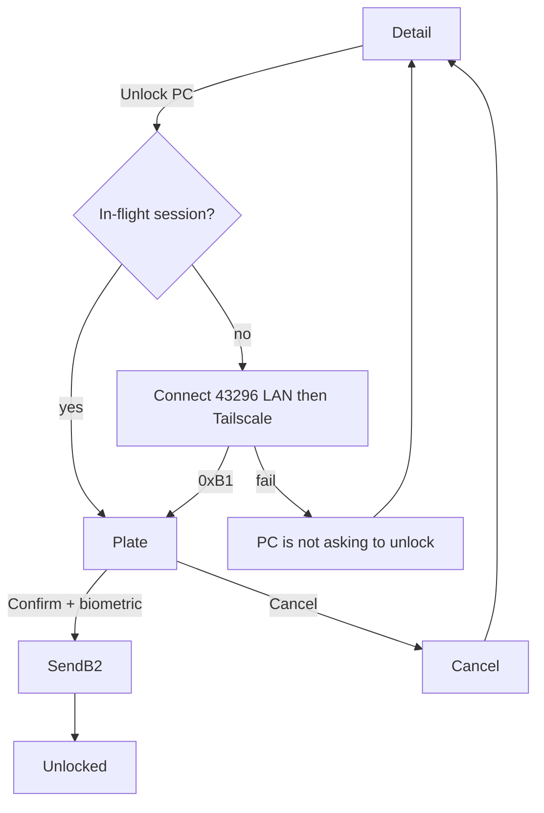
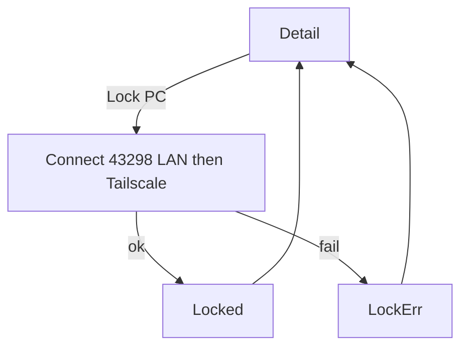

# Product Design

## Design principles

1. **The phone is still a key, not a Tailscale console.** No tailnet maps, no “connected / DERP / relay” chrome. Overlay is an address, not a mode.
2. **Armed rail still means unlock listening**, not “Tailscale up.” Overlay does not change the rail.
3. **Unlock PC is the brass action on detail.** It is the missed-notification recovery and needs biometrics. Lock PC stays one-tap and is not a second brass control.
4. **Copy names the outcome.** “Unlocked.” / “PC isn’t asking to unlock.” / “Tailscale hasn’t been seen yet.” No “overlay path,” no “CGNAT.”
5. **The unlock plate is unchanged.** Phone-initiated Unlock PC still ends on that plate once the PC asks (`0xB1`). Do not invent a second confirm UI.

Visual thesis: same locksmith bench. Tailscale is extra reach for the same key, not a new product skin.

## User journeys and flows

**Missed notification**  
Home → PC row → detail → Unlock PC → (in-flight) plate already waiting → Confirm → biometric → “Unlocked.”

**Phone-initiated while PC is waiting**  
Detail → Unlock PC → caption “Unlocking…” → plate (hostname, user, program) → Confirm → biometric → “Unlocked.”

**PC not waiting**  
Detail → Unlock PC → caption “PC isn’t asking to unlock.” Stay on detail. No plate.

**No overlay IP yet**  
Detail: Unlock PC and Lock PC still work on LAN if `lastIpv4` exists. Tailscale spec row “Not seen.” Caption if they are off-LAN: “Tailscale hasn’t been seen yet. Open Tailscale on the phone and PC, then unlock once on home Wi-Fi.”

**Lock away**  
Detail → Lock PC → “Locking…” → “Locked.” Same as lock-pc. No plate, no biometric.

**PC-initiated unlock on cellular**  
Existing FGS / full-screen plate. No new home chrome. User never has to open detail if the notification fires.

**Home with Tailscale quit**  
LAN first. No error toast that Tailscale is down.

## Information architecture

No new top-level destination. No Tailscale settings screen.

```
Home
 └── PC row → Detail
                ├── Unlock PC  (brass)
                ├── Lock PC    (ghost)
                ├── Shut down | Restart  (power-control)
                └── Remove PC  (refuse, confirm)
Unlock plate (system overlay)  ← PC-initiated or after Unlock PC hears 0xB1
```

Logs may append unlock/lock lines with path LAN or Tailscale (not in the primary UI). Desktop Qt: no Tailscale page, no overlay-IP field in Settings.

## Screens and states

**PC detail (this feature)**  
Hostname at 34. Spec sheet hairlines: OS, method, user, truncated device id, **Tailscale** (Plex Mono `100.x` or Mute “Not seen”). Method label stays UDP/TCP/BT — do not rename the method to Tailscale.

Dock, top to bottom:

1. One-line status (Mute / Ok / Refuse)
2. **Unlock PC** — brass primary, 48dp
3. **Lock PC** — ghost (hairline stroke, Paper), 48dp
4. **Shut down | Restart** — quieter ghost row (`agentic/features/power-control/design.md`)
5. Remove — refuse footnote

**PC detail / unlocking**  
Unlock PC disabled. Caption “Unlocking…” Mute. Lock PC also disabled while this attempt is in flight.

**PC detail / in-flight resume**  
Do not show “Unlocking…” on detail; jump to the unlock plate.

**PC detail / unlocked**  
If the plate was shown: plate “Unlocked.” ~800ms then back to detail. If we never left detail (should not happen on success — success is the plate): do not invent a detail-only success for unlock.

**PC detail / not asking**  
Caption Refuse: “PC isn’t asking to unlock.” Unlock PC enabled again.

**PC detail / no address**  
Both actions tappable into the error (not silent). No LAN and no Tailscale: “This PC hasn’t been seen on this Wi-Fi or Tailscale yet. Unlock once while both are on the same network with Tailscale open.”

**PC detail / Tailscale unseen, LAN present, off-LAN failure**  
After a failed Tailscale attempt: “Couldn’t reach the PC over Tailscale. Confirm Tailscale is on and JarvisAuth is running.”

**Lock states**  
Unchanged from lock-pc (“Locking…” / “Locked.” / reachability), except reachability copy may mention Tailscale when the Tailscale hop was the one that failed.

**Unlock plate**  
Unchanged: hostname, user, program, Confirm, Cancel. No “via Tailscale” line. Path is a log concern.

**Home**  
Unchanged. No Tailscale badge on rows.

**Desktop**  
Unchanged shell. Do not add a Tailscale checkbox or overlay-IP field. Tray / Quit copy stays as in project design.

## Interaction behavior

- Unlock PC: if `UnlockSession` exists for that `deviceId`, present the plate immediately. Otherwise connect (LAN then Tailscale) to unlock port; on `0xB1` present the plate; Confirm runs BiometricPrompt; success writes `0xB2`.
- Cancel on the plate or biometric sheet sends `CANCEL` and returns to detail.
- Back during “Unlocking…” cancels the phone TCP; the PC may still be waiting. User can tap Unlock PC again.
- Lock PC still fires immediately, no confirm, no biometric.
- Do not start FGS from Unlock PC. In-flight resume may use an existing FGS socket.
- No pull-to-refresh. No home Unlock shortcut.
- Motion: existing 180ms rail / 200ms plate only. Status text replaces, no bounce.

## Responsive behavior

Phone-only, portrait. Dock buttons full-width 48dp. Unlock plate stays portrait-locked. No tablet layout.

## Accessibility

- Unlock PC and Lock PC are 48dp, labeled with those strings, not icon-only.
- Status is text, not color-only.
- TalkBack: announce status changes; Tailscale spec row is “Tailscale, {address or Not seen}.”
- Unlock plate Confirm/Cancel remain 48dp. BiometricPrompt is the platform sheet.
- Reduced motion respected.

## Visual direction

Unchanged locksmith thesis. Do not add the Tailscale logo, a globe, or a second rail for “remote.” Overlay IP lives in the spec sheet like a stamped key number.

Avoid: VPN-app status cards, green “secure tunnel” pills, QR for Tailscale, pairing-method rename.

## Design system

Reuse project tokens. No new colors or typefaces.

### Colors

Night, Steel, Hairline, Brass, Brass dim, Paper, Mute, Refuse, Ok — same hex as `agentic/design.md`.

### Typography scale

Sora for Unlock PC, Lock PC, status, hostname. Plex Mono for Tailscale IP and device id.

### Spacing

4dp grid. Detail padding 20. Spec row 48. Dock padding 16/20. Buttons 48dp. 8dp between Unlock PC and Lock PC. Status 12 above Unlock PC.

### Radii

Buttons 6dp.

### Shadows

None.

### Icons

None for Unlock PC or Tailscale. No globe, no Tailscale mark.

### Components and variants

- **Unlock PC** — PrimaryButton, docked, brass.
- **Lock PC** — Ghost button, docked (was primary in lock-pc; this feature demotes it so brass is spent once).
- **Unlock/lock status** — body Medium Mute, Ok, or Refuse, above Unlock PC.
- **Tailscale spec row** — label Mute 12, value Plex Mono Paper or Mute “Not seen.”
- **Unlock plate** — unchanged.

### Interactive states

Unlock PC disabled at 40% while unlocking, while the plate is up, or when no address exists (still tappable to the missing-address caption). Lock PC disabled while unlocking or locking. Pressed brass dim on Unlock PC; ghost pressed = Hairline fill.

## Diagrams




