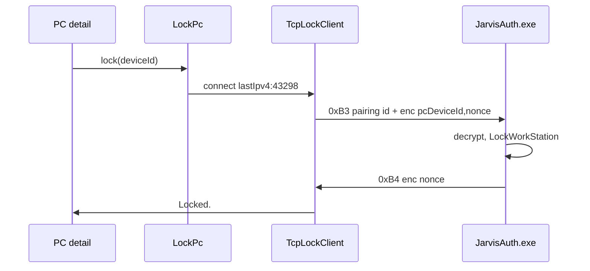

# Technical Architecture

## System context

Phone-initiated lock. Desktop GUI in the interactive Windows session owns `LockWorkStation`. Unlock login UI is a separate process and keeps port 43296.

```
┌─────────────┐  TCP 43298 AES    ┌──────────────────┐
│  Android    │ ───────────────► │ JarvisAuth.exe   │ ── LockWorkStation
│  PC detail  │ ◄── 0xB3 / 0xB4  │  user session    │
└─────────────┘                   └──────────────────┘
```

## Technology stack and rationale

| Piece | Choice | Why |
|---|---|---|
| Desktop lock API | `LockWorkStation` (`user32`) | Session lock; no password, no credential provider |
| Transport | `java.net.Socket` / existing C++ `BaseConnection` | Same framing as unlock |
| Crypto | Existing AES-256-GCM 16-byte IV | Same `encryptionKey` as pairing |
| Android UI | Compose PC detail + ViewModel | No sockets in `ui/` |
| Desktop listener | Thread in the GUI process | Must be the interactive session; a SYSTEM service cannot lock the user session cleanly |

Not used: FGS, RFCOMM, UDP beacon, HTTP.

## Component and service boundaries

**Android**

- `domain/LockPc` — validate pairing + IP, call transport, map errors.
- `transport/TcpLockClient` — connect, write 0xB3, read 0xB4, timeout.
- `protocol` — lock JSON models + packet ids.
- `data` — persist `lastIpv4` on `Pairing`.
- `ui/home/PcDetailViewModel` — tap Lock PC.
- Do not start lock from `UnlockForegroundService`.

**Desktop (Windows only)**

- `LockServer` (name as implemented) — bind `lockServerPort` (default 43298) while JarvisAuth.exe is running in the user session (the window may be hidden in the tray).
- On 0xB3: lookup `PairedDevice` by pairing id, decrypt, `LockWorkStation`, write 0xB4.
- Linux/macOS: no listener.

`ui` must not import `transport`. Desktop Qt UI must not contain crypto; lock server lives next to other connection code under `common/` or `desktop/src` connection helpers.

## Data model and storage

Android `Pairing` additive field:

```
lastIpv4: String = ""   // dotted quad; never a hostname
```

Filled from: pairing beacon `ip`, UDP broadcast `pcbuIP`, inbound TCP unlock `Socket.inetAddress`. Skip non-IPv4.

Desktop `AppSettings`:

```
lockServerPort: uint16 = 43298
```

No new pairing-file field on the PC (phone uuid + encryptionKey already exist). Phone does not store `lockServerPort` in v1 (always 43298).

## API contracts

Framing, AES blob, PBKDF2, 120s skew: identical to unlock.

- `0xB3`: `{ "protoVersion": "1.0.0", "deviceId": "<pairing id>", "encData": "<hex>" }`

`deviceId` is `PairedDevice.id` / Android `Pairing.deviceId` (SHA256 of machineID+phoneUUID+userName), not the raw phone uuid.

`encData` decrypts to:

```
{ "pcDeviceId": "<same pairing id>", "nonce": "<random 32+ chars>" }
```

**Lock response** PC → phone `0xB4` JSON:

```
{ "error": "", "encData": "<hex>" }   // success
{ "error": "TIME_ERROR|DATA_ERROR|NOT_PAIRED|PROTOCOL_ERROR|APP_ERROR", "encData": "" }
```

Success `encData` decrypts to `{ "nonce": "<same nonce>" }`. Echo proves the PC held the key. Never include `passwordKey`.

Phone sends **no** `0xB0` on this socket. Desktop lock server always knows to read 0xB3 first (`needsDeviceID` does not apply).

Payload cap: same 2KB `CRYPT_BUFFER_SIZE`.

Connect/read timeout: 8s on the phone (shorter than unlock’s ~125s; this is a tap, not a biometric wait).

## External integrations

- Windows: `LockWorkStation`. False return → `APP_ERROR`.
- Windows Firewall inbound TCP 43298 to JarvisAuth.exe (installer if we already add pairing/unlock rules).
- No other OS APIs. No internet.

## Authentication and authorization

Success requires all of:

1. TCP to the stored IPv4 and lock port.
2. Outer `deviceId` matches a stored `PairedDevice.id`.
3. Decrypt with that device’s `encryptionKey`.
4. `protoVersion == 1.0.0` for lock. Proto `1.1.0` + inner `action` is `agentic/features/power-control/` (same socket).
5. Timestamp skew ≤ 120s.
6. Inner `pcDeviceId` equals this machine’s paired desktop id as stored on the phone / as the PC computes for unlock requests.
7. User session can be locked.

Fail any step → error or close; never lock on decrypt failure.

Desktop id check: use the same string the PC already puts in unlock `0xB1` `deviceId` so the phone can send `pairing.deviceId` as `pcDeviceId`.

## Security and privacy

- Tap-to-lock: possession of the unlocked phone is enough. Documented.
- Replay inside 120s may lock again (idempotent). No extra nonce store required for v1.
- Lock listener exposes that a JarvisAuth session is up on 43298. Encrypted payloads only.
- Do not log IPs in full if we can avoid it; last octet or none. Never keys.

## Performance and scalability

One accept at a time is enough. Do not hold the accept thread across `LockWorkStation` longer than needed. One user, handful of phones.

## Observability

Android `AppLog`: `lock sent` / `lock ok` / `lock failed TIME_ERROR` with truncated ids. Desktop spdlog equivalent without keys.

## Deployment and environments

- Desktop Windows installer + Android APK both required.
- Linux/macOS desktop builds ignore lock.
- JDK 17 / existing CMake. No new third-party libs.

## Testing strategy

1. JVM: lock request/response JSON + encrypt round-trip; proto mismatch; bad deviceId → NOT_PAIRED; success payload has no `passwordKey`.
2. Desktop unit/integration if feasible: packet parse; refuse unknown phone.
3. Hardware: existing pairing, store IP via one UDP unlock, tap Lock PC, session locks. Quit desktop → reachability error. Unlock still works. Firewall noted if it fails.

## Architectural decisions and consequences

**AD-L1 New packets, not overloaded 0xB1.** Unlock state machine stays untouched.

**AD-L2 New port 43298.** Login TCP unlock keeps 43296 when the session is locked.

**AD-L3 GUI-process listener, not Windows service.** `LockWorkStation` needs the interactive session. Closing the window hides to the tray and keeps the listener. Tray **Quit** (or killing the process) disables lock.

**AD-L4 Persist last IPv4, no beacon.** Consequence: first lock after upgrade may fail until one LAN unlock/pair. BT-only never-on-LAN cannot lock.

**AD-L5 Hardcoded phone port 43298.** Consequence: custom desktop lock ports need a later pairing field; v1 prefers no re-pair.

**AD-L6 No FGS.** Lock is a foreground user tap.

## Diagrams


