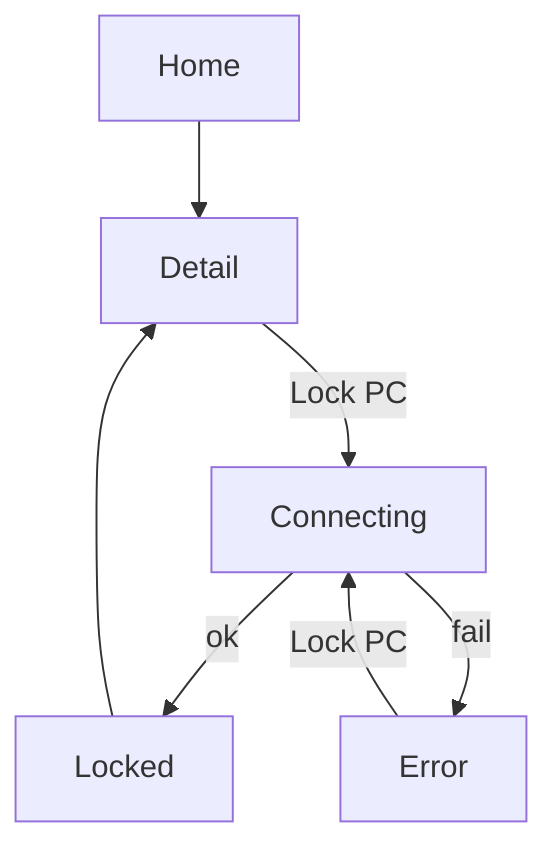

# Product Design

## Design principles

1. **Lock is one action on a PC you already know**, not a new home mode. Home stays pair / listen.
2. **Armed rail still means unlock listening**, not “lock ready.” Lock does not change the rail.
3. **Copy names the outcome.** “Locked.” / “Couldn’t reach the PC.” No “session transition.”
4. **Lock PC is one tap, not a second brass control.** Internet-reach puts **Unlock PC** as the brass dock action on detail. Lock PC is ghost. Remove stays refuse.
5. **No plate, no biometric sheet.** Unlock keeps the full-screen plate. Lock stays on PC detail.

Visual thesis: same locksmith bench. Lock is a key-turn on an existing row, not a remote-desktop console.

## User journeys and flows

**Happy path**  
Home → PC row → detail → Lock PC → button busy → “Locked.” → session is at the Windows lock screen.

**No IP yet**  
Detail shows Lock PC disabled (or tappable into the error). Caption: “This PC hasn’t been seen on this Wi-Fi yet. Unlock once while both are on the same network.”

**Unreachable**  
Tap Lock PC → “Couldn’t reach the PC. Confirm JarvisAuth is running and you’re on the same Wi-Fi.” Retry stays on the same screen.

**Time / protocol / not paired**  
Same sentences as unlock/pair: clocks, different versions, not paired.

**Bluetooth pairing without IP**  
Same missing-IP copy. No Bluetooth lock control.

## Information architecture

No new top-level destination.

```
Home
 └── PC row → Detail
                ├── Lock PC
                └── Remove PC (confirm)
```

Logs may append lock lines. No lock overlay activity.

## Screens and states

**PC detail (extended)**  
Hostname at 34. Spec sheet (label / value hairlines): OS, method, user, truncated device id. No Steel blocks.  
Dock: optional one-line status, then Unlock PC (brass, internet-reach) and Lock PC (ghost). Remove is a refuse footnote under the dock, with confirm.

**PC detail / locking**  
Primary button disabled. Caption “Locking…” Mute. No spinner circus.

**PC detail / locked**  
Caption “Locked.” Ok token. Auto-clear status after ~1.2s. User can leave the screen immediately.

**PC detail / error**  
Caption Refuse color, one sentence, Retry is tapping Lock PC again.

Home, pair, unlock plate, logs, battery: unchanged.

## Interaction behavior

- Lock PC sends immediately. Back during “Locking…” cancels the in-flight TCP on the phone; the PC may still lock if the packet was already accepted. Do not pretend the phone can unsend.
- Remove confirm is unchanged and is not used for lock.
- No pull-to-refresh, no home Lock shortcut.
- Motion: none beyond existing 180ms rail (unused here). Status text replaces, no bounce.

## Responsive behavior

Phone-only, portrait. Lock is the dock primary (full-width 48dp). No tablet layout.

## Accessibility

- Lock PC is 48dp, labeled “Lock PC”, not an icon-only control.
- Status is text, not color-only (Locked. / error sentence).
- TalkBack: announce status when it changes.

## Visual direction

Unchanged product thesis. Do not add a padlock illustration or a second armed rail for lock.

## Design system

Reuse project tokens. No new colors or typefaces.

### Colors

Night, Steel, Hairline, Brass, Brass dim, Paper, Mute, Refuse, Ok — same hex as `agentic/design.md`.

### Typography scale

Sora for Lock PC and status. Plex Mono only for the existing device id row.

### Spacing

4dp grid. Detail padding 20. Spec row 48. Dock padding 16/20. Button 48dp. Status 12 above the primary in the dock.

### Radii

Buttons 6dp.

### Shadows

None.

### Icons

None for lock. No extra key glyph on the button.

### Components and variants

- **Lock PC** — Ghost button, docked (Unlock PC is brass; see internet-reach design).
- **Lock status** — bodyMedium Mute, Ok, or Refuse, immediately above the primary in the dock.
- **Spec row** — same as project design (label / value hairline).

### Interactive states

Primary disabled at 40% opacity while locking or when no IPv4. Pressed Brass dim.

## Diagrams


