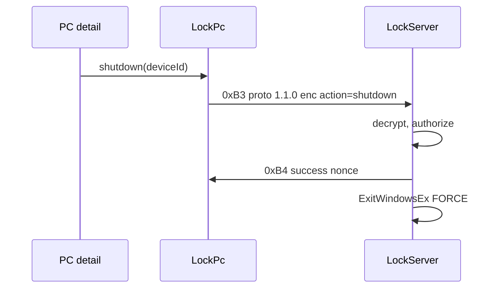

# Technical Architecture

## System context

Phone-initiated power uses the **lock** TCP server in the interactive Windows session. Unlock login keeps 43296.

```
Phone PC detail  --0xB3/0xB4 TCP 43298 AES-->  JarvisAuth.exe
                                              |-- LockWorkStation     (proto 1.0.0)
                                              |-- ExitWindowsEx FORCE (proto 1.1.0 + action)
```

## Technology stack and rationale

| Piece | Choice | Why |
|---|---|---|
| Power API | `ExitWindowsEx` + `EWX_FORCE` after `SE_SHUTDOWN_NAME` | Forced; no extra process; user session |
| Transport | Existing `TcpLockClient` / `LockServer` | Same socket as lock |
| Crypto | Existing AES-256-GCM 16-byte IV | Frozen lock framing |
| Proto | Lock **1.1.0** + inner `action` | Old exe exact-matches `1.0.0` → `PROTOCOL_ERROR`, does not lock |
| Android | `LockPc` (or thin wrapper) with action; Compose row | UI has no sockets |

Not used: new packet IDs, new port, `shutdown.exe`, FGS, Tailscale SDK, HTTP.

## Component and service boundaries

**Android**

- Reuse `LockPc` / `LockHandshake` / `TcpLockClient`. Lock stays proto `1.0.0` and omits `action`. Power sends `1.1.0` + inner `action`.
- `PcDetailViewModel` — Shut down / Restart. Do not start FGS.
- Host order unchanged: LAN then Tailscale, port 43298.

**Desktop (Windows only)**

- `LockServer`: if outer proto `1.0.0` → current lock path. If `1.1.0` → decrypt, require `action`, ACK `0xB4`, then `ExitWindowsEx`.
- `GetLockProtocolVersion()` may stay `1.0.0` as the **lock** version string the phone uses for Lock PC. Server **accepts** `1.0.0` and `1.1.0` explicitly. Do not switch to a single exact-match on `1.1.0` (that would break Lock PC from a new phone that still sends `1.0.0`).
- Linux/macOS: no listener.

`ui` must not import `transport`. No crypto in Compose/QML.

## Data model and storage

No new pairing fields. `lastIpv4` / `lastTailscaleIpv4` as internet-reach.

Inner request (encrypted):

```
{ "pcDeviceId": "<pairing id>", "nonce": "<random>", "action": "shutdown"|"restart"|"lock" }
```

`action` omitted on proto `1.0.0` (lock). Required on `1.1.0`.

Outer `0xB3` still `{ protoVersion, deviceId, encData, optional tsIP }`. Do not put `action` on the outer JSON (plaintext on the lock socket besides deviceId).

## API contracts

Framing, AES, 120s skew, header, 43298: unchanged.

- Lock: `protoVersion: "1.0.0"`, inner without `action`.
- Power: `protoVersion: "1.1.0"`, inner `action` `shutdown` or `restart`.
- Response `0xB4`: same as lock. Success nonce echo. Never `passwordKey`.

Phone still sends **no** `0xB0` on this socket.

Connect/read timeout: 8s per hop, same as lock.

**Order:** decrypt and authorize → write success `0xB4` → `ExitWindowsEx`. Privilege failure → `APP_ERROR`, no power.

## External integrations

- Windows: `AdjustTokenPrivileges` (`SE_SHUTDOWN_NAME`), `ExitWindowsEx(EWX_SHUTDOWN|EWX_FORCE)` or `EWX_REBOOT|EWX_FORCE`.
- Same firewall hole as lock (43298).
- No `InitiateSystemShutdownEx` unless `ExitWindowsEx` is insufficient; prefer one API.

## Authentication and authorization

Same seven lock checks, plus:

- `1.1.0` ⇒ `action` in `{shutdown, restart, lock}`.
- `action=lock` on `1.1.0` is allowed but the phone must not send it (Lock PC uses `1.0.0`).

Never power on decrypt failure.

## Security and privacy

- Possession of the unlocked phone is enough. Documented. Overlay makes it remote.
- Replay inside 120s may shut down a machine that came back — accepted for v1; no extra nonce store.
- Do not log full IPs at info. Never keys. `action=` is allowed.

## Performance and scalability

One accept at a time. Do not start `ExitWindowsEx` before the success packet is written.

## Observability

Android `AppLog`: `lock` / `shutdown` / `restart` with truncated id and `path=lan|tailscale`. Desktop spdlog: action + result, no keys.

## Deployment and environments

- New APK **and** new `JarvisAuth.exe` in Program Files. Installer still does not replace the GUI.
- Linux/macOS ignore this slice.

## Testing strategy

1. JVM: lock `1.0.0` omits `action`; power `1.1.0` includes it; success has no `passwordKey`; decode ignores unknown inner keys on `1.0.0`.
2. Desktop: `1.0.0` still `LockWorkStation`; `1.1.0` shutdown/restart path (can stub `ExitWindowsEx` in unit tests if hooked; otherwise compile + hardware).
3. Hardware: new exe + APK, Shut down / Restart; Lock still works; old exe + new APK power tap does not lock or power off.

## Architectural decisions and consequences

**AD-W1 Same socket as lock, not new IDs.** Consequence: one firewall rule; lock proto must version.

**AD-W2 Proto 1.1.0 for power only.** Consequence: old exe fail-closes power; lock from new phone still `1.0.0`.

**AD-W3 `action` inner, not outer.** Consequence: not in plaintext JSON next to `deviceId`.

**AD-W4 ACK then force.** Consequence: phone can show success; if the ACK is lost the PC may still go down.

**AD-W5 Force, not graceful.** Consequence: unsaved work is gone. Remote tap actually completes.

**AD-W6 No FGS.** Power is a foreground tap.

## Diagrams


