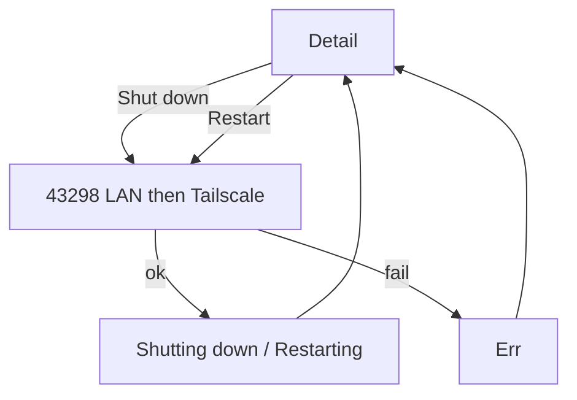

# Product Design

## Design principles

1. **Power is extra reach on a PC you already know**, not a new home mode and not a Tailscale console.
2. **Armed rail still means unlock listening.** Shutdown/Restart do not change the rail.
3. **Copy names the outcome.** “Shutting down.” / “Restarting.” No “EWX_FORCE.”
4. **Unlock PC stays brass. Lock PC stays the full-width ghost.** Shut down and Restart are quieter, side by side, under Lock.
5. **No plate, no biometric.** Same as Lock PC.

Visual thesis: same locksmith bench. Power is a smaller stamp on the existing key card, not a red emergency panel.

## User journeys and flows

**Shutdown**  
Home → PC row → detail → Shut down → row busy → “Shutting down.” → PC powers off.

**Restart**  
Same with Restart → “Restarting.” → PC reboots.

**No address**  
Tappable into the existing missing-address caption (Wi-Fi or Tailscale). No silent no-op.

**Unreachable / old exe**  
One-line Refuse caption (reachability or different versions). Retry is another tap.

**Stolen phone**  
One tap from anywhere the lock path works. No extra UI. Accepted.

## Information architecture

No new top-level destination.

```
Home
 └── PC row → Detail
                ├── Unlock PC     (brass)
                ├── Lock PC       (ghost, full width)
                ├── Shut down | Restart  (quieter row)
                └── Remove PC     (refuse, confirm)
```

Logs may append `action=shutdown|restart`. No new overlay activity.

## Screens and states

**PC detail dock, top to bottom**

1. One-line status (Mute / Ok / Refuse)
2. **Unlock PC** — brass, 48dp (internet-reach)
3. **Lock PC** — ghost, 48dp, 8dp below Unlock
4. **Shut down | Restart** — two equal ghost buttons in one row, 8dp below Lock, 48dp tall, 8dp gap between them
5. Remove — refuse footnote

**Busy**  
Unlock, Lock, and the power row disabled while unlocking, locking, or a power tap is in flight. Caption “Shutting down…” or “Restarting…” Mute.

**Success**  
“Shutting down.” / “Restarting.” Ok. Auto-clear ~1.2s (the PC may already be gone).

**Error**  
Refuse one sentence. Same lock reachability / Tailscale / version copy. Power-specific: old exe → different versions (existing protocol sentence).

Home, pair, unlock plate, logs, battery: unchanged. Desktop Qt: no power settings page.

## Interaction behavior

- Shut down / Restart send immediately. Back during the in-flight TCP cancels the phone socket; the PC may still power off if it already accepted.
- No confirm sheet. Remove confirm is not reused for power.
- No home shortcuts. No FGS start.
- Motion: status text replaces only.

## Responsive behavior

Phone-only, portrait. Power row full-width, two columns. No tablet layout.

## Accessibility

- Buttons labeled “Shut down” and “Restart”, 48dp, not icon-only.
- Status is text, not color-only.
- TalkBack: announce status; buttons are those strings.

## Visual direction

No power glyph, no red panic color, no Tailscale mark. Ghost Hairline like Lock PC. Do not spend brass on power.

## Design system

Reuse project tokens. No new colors or typefaces.

### Colors

Night, Steel, Hairline, Brass, Brass dim, Paper, Mute, Refuse, Ok — same as `agentic/design.md`.

### Typography scale

Sora for Shut down, Restart, status. Plex Mono only for existing spec rows.

### Spacing

4dp grid. 8dp between Unlock and Lock, 8dp between Lock and the power row, 8dp between Shut down and Restart. Status 12 above Unlock PC.

### Radii

Buttons 6dp.

### Shadows

None.

### Icons

None.

### Components and variants

- **Shut down / Restart** — Ghost buttons, equal weight, one row.
- **Status** — shared with lock/unlock captions.

### Interactive states

Disabled at 40% while busy or when no address (still tappable into the missing-address caption). Pressed = Hairline fill.

## Diagrams


